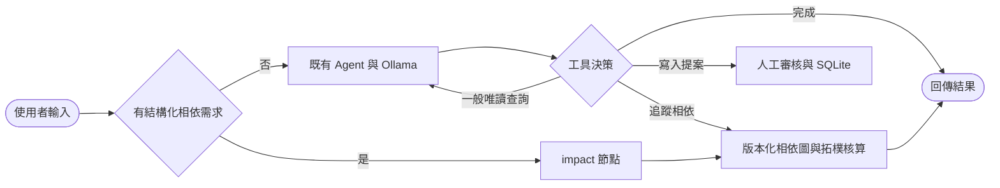

# 作業三技術說明與評分對照

## 需求與實作

本次完成作業一的 FR-05。作業二基準 [`2555408`](https://github.com/MRsiasia/ai-agent-schedule/tree/2555408a94491a9f40fb4270cc199b6154a37c70) 具備日曆查詢、硬性排程檢核、受控寫入及有界工具迴圈。新版沿用 `check_schedule_constraints` 的計算邏輯與原作業的人工核准路徑。版本化的相依資料、拓樸預測及唯讀終止路由提供跨任務的分鐘級證據。

自然語言的相依工具在 `tools` 節點執行 `trace_task_impact`，有效工具回傳會原樣交付並終止相依流程。工具參數驗證失敗則由原有工具錯誤路由交回 Agent。一次請求同時被模型解讀為相依分析與寫入提案時，當次會返回相依分析結果。需要寫入行事曆時可另行提出請求並照原流程確認。

| 項目 | 規格 |
|---|---|
| 工具 | `trace_task_impact`，LangGraph 自然語言入口登錄為 `tool_trace_task_impact` |
| 輸入 | `task_id`、`delay_minutes`（0 至 100,800 整數）、`dag_version`、`max_depth`（0 至 64，預設 64） |
| 資料 | `data/dependencies.json` 含擁有者、版本、台北本地分鐘、任務 ID、起訖、期限及前置 ID |
| 輸出 | `status/data/error/evidence/timestamp`，含原任務、受影響清單、期限裕量、完整控制路徑、前置完成時間、截斷與缺漏 ID |
| 計算 | 保留原工期。設定根節點順延量後，後繼開始為原開始與所有前置預測完成的最大值。期限裕量為截止減預測完成，負值表示違約 |
| 可重現性 | 同時間的前置完成以任務 ID 決定控制路徑，拓樸節點以 ID 決定順序 |
| 邊界 | 掃描從根可達的下游以辨識循環。若最長受影響拓樸深度超過上限，該節點標為截斷，避免用不完整的匯合計算宣告安全 |
| 權限 | 先檢查伺服器身分及資料擁有者。相依工具只讀取資料。LangGraph 可存執行狀態至 SQLite |

### 失敗與復原

| 狀況 | 回傳 | 復原方式 |
|---|---|---|
| 檔案、版本、任務或前置資料不全 | `DAG_NOT_FOUND`、`DAG_VERSION_MISMATCH`、`UNKNOWN_TASK`、`UNKNOWN_PREDECESSOR` | 補齊檔案、確認任務 ID、改用正確版本 |
| 格式違規或重複任務 | `INVALID_DAG`、`DUPLICATE_TASK` | 檢查時間順序、ID 與檔案格式 |
| 有下游循環或原先排程不滿足相依 | `CYCLE_DETECTED`、`INCONSISTENT_BASELINE` | 用回傳節點或邊修正計畫後重算 |
| 缺期限或深度截斷 | `PARTIAL_IMPACT` | 補上期限或提高深度，已知預測仍可供查核 |
| 身分或資料擁有者不符 | `DENIED` | 選擇已授權資料集 |

分析的假設為結束到開始、有固定工期、前置依賴已知、台北本地時間。結果可跨日期，但不自動處理共享人力與地點衝突。要安排實際新時段，應再以既有排程檢核工具核算。T11、T12 的候選枚舉與偏好排序是兩組共用的評估器程式，用來檢驗原檢核證據可以支持什麼決策。

## 評分項目

| 評分 | 交付證據 |
|---|---|
| 技術改善實作 5% | [DAG 工具](../src/dependencies.py)、[LangGraph 路由](../src/agent.py)、[CLI](../src/cli.py)、[邊界與既有功能測試](../tests/) |
| 實驗設計 4% | [測試資料與手算標準](../evaluation/cases.json)、[評估程式](../evaluation/run.py)、[實驗報告](HW3_Experiment_Report.pdf) |
| 結果分析 4% | [實驗報告](HW3_Experiment_Report.pdf) 的配對結果、期限計算、模型誤差與限制，以及 [原始證據](../logs/hw3/) |
| 技術文件 2% | [使用與重現方式](../README.md)、本文件、[Podman 執行紀錄](../logs/hw3/podman-verification.txt) |
